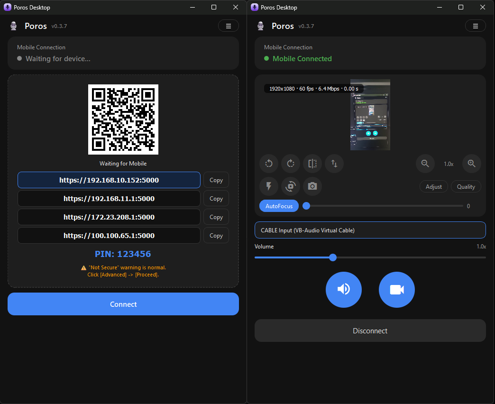
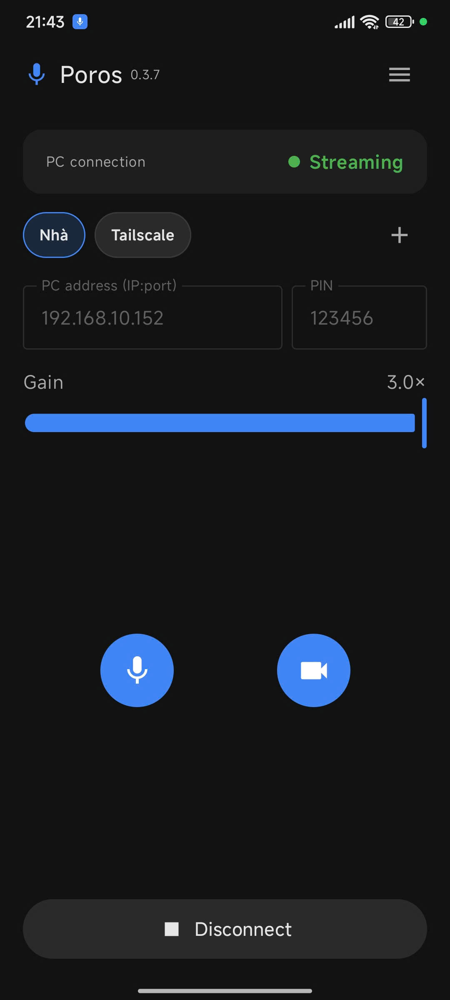

<div align="center">
  
  <h1>Poros</h1>
  <p><strong>Use your phone as your PC's microphone and camera.</strong></p>
  <p>No account. Nothing leaves your Wi‑Fi.</p>

  <p>
    
    
    
  </p>
</div>

---

## What it looks like

**Desktop** — waiting for your phone on the left, streaming on the right:



**Android**



## Usage

**Just a web page** Open the IP showed on the desktop app via browser on the phone and you have a microphone. No camera tho.

**The Poros app.** Install `Poros-Client-<version>.apk` for mic and camera.

| | Web page | Poros app |
| --- | --- | --- |
| Microphone | Yes | Yes |
| **Camera** | **No** | **Yes** |
| Keeps working when the phone screen locks | **No** | **Yes** |

So: use the web page for a quick microphone, install the app for camera work and long calls.

## Getting started

**You need:** a Windows 64‑bit PC, an Android phone (8.0 or newer), and both on the same Wi‑Fi.

**1. Download** from [Releases](https://github.com/timuela/Poros/releases):

**2. Run Poros on the PC.** The first time, it installs a virtual audio device and Windows asks for
permission. Say yes. This takes a few seconds.

**3. Connect the phone.** Either:

- **Web page:** open the address the PC is showing — something like `https://192.168.1.42:5000` —
  in the phone's browser. Or point the phone camera at the QR code on the PC to open it.
- **App:** type in IP (Default Port is `5000`) or save it as a profile.


**5. Type the PIN** shown on the PC window. You can change it, or turn it off entirely, in
Settings.

**6. Point your app at Poros's microphone.** In the game, Discord, Zoom, OBS — wherever — pick
the virtual device as the microphone input:

| Your PC | Choose this microphone |
| --- | --- |
| Windows | `CABLE Output (VB-Audio Virtual Cable)` |

*(You'll also see a `CABLE Input` device — that's the other end of the same cable. Poros plays
into it, so you record from `CABLE Output`.)*

**7. Talk.**

## Camera

The phone camera becomes a normal Windows webcam named **Poros Virtual Camera**.

1. On the phone, tap the round **camera button** next to the microphone button.
2. On the PC, press the round **camera button** at the bottom. The first time, Windows asks for
   permission to install the virtual camera — say yes.
3. The picture appears in the Poros window, and *Poros Virtual Camera* becomes selectable in
   Zoom, OBS — anywhere you pick a camera.

The phone encodes with its hardware encoder, so it can stream up to **4K60fps**. Best is **1080p60 over TCP**;

Tested on Redmi K40s at 4K60fps / Bitrate 6000kbps

## Troubleshooting

**My phone says the connection isn't private.**
That's normal and safe. Tap **Advanced**, then **Proceed**.

**My PC suddenly has no sound.**
The driver installer sometimes makes the virtual cable your default speaker. Click the speaker
icon in the taskbar and switch back to your real speakers or headphones.

**"PIN error" on the phone.**
Type the PIN exactly as it appears on the PC window. If it still refuses, press **New PIN** on the
PC and try the fresh one.

**The camera button does nothing.**
Turn the camera on from the phone app first — the PC can only stream a camera the phone has switched on.

**The virtual camera doesn't appear in Zoom/OBS.**
It is installed the first time you start the camera; after that, reopen the app that should see it. Some apps only list cameras when they start.

**The picture stutters.**
Lower the resolution or frame rate in **Quality**, and keep the transport on **TCP**. Move the phone and PC onto the same access point — Wi‑Fi extenders and guest networks are the usual culprit.

**My phone can't reach the PC.**
Check both are on the same Wi‑Fi, and that you used the address the PC is actually showing — if you're on a VPN or Tailscale, pick that address. Guest Wi‑Fi and "client isolation" block phone-to-PC traffic entirely.

## Building from source

You need **Python 3.11 or newer**, and for the phone app **JDK 17** with the Android SDK.
`dev\setup.ps1` fetches both and creates the Python virtualenv — about 700 MB, one time, no admin
rights, and nothing installed system-wide:

```powershell
powershell -ExecutionPolicy Bypass -File dev\setup.ps1
```

Then build whichever half you need:

```powershell
dev\run-host.ps1          # run the host straight from source - the fast way to iterate
dev\build-host.ps1        # dist\Poros\ plus the portable exe
dev\build-installer.ps1   # the installer (needs Inno Setup 6)
dev\build-apk.ps1         # the phone app
```

The version comes from `VERSION` in `main.py` — bump that and every script follows, locally and in
CI. [dev/README.md](dev/README.md) has the longer version, including troubleshooting.

Or if u prefer manually:

```bash
python -m venv .venv
.\.venv\Scripts\activate
pip install -r requirements.txt
pip install -r requirements-windows.txt
.\build.bat                # -> dist/Poros/

cd android
gradlew.bat assembleRelease   # ./gradlew on Linux/macOS
```

Gradle needs `ANDROID_HOME` and `JAVA_HOME` pointing at the SDK and at JDK 17 (AGP rejects newer
JDKs); `dev\setup.ps1` sets that up for you.

## License

[GPL-3.0](LICENSE) — free to use, modify and share, as long as derivatives stay open under the
same licence.
